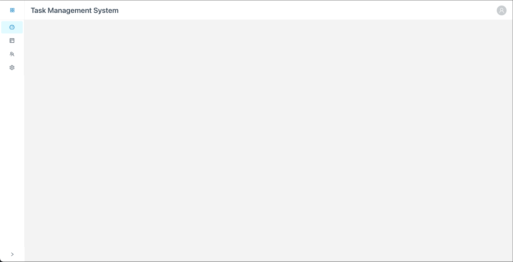

# Deepset - Task Management System Challenge

This task is designed to assess your technical expertise, problem-solving skills, and ability to deliver efficient and polished solutions within a limited time.



---

## Your Task

Implement a real-time collaborative Task Management System with the following requirements:

### 1. Real-Time Task Updates

- Enable real-time synchronization of tasks using a provided mock WebSocket server.
- Ensure updates are reflected across simulated clients in real time.

### 2. Kanban-Style Task Board

- Create a task board with three columns: **To Do**, **In Progress**, and **Done**.
- Implement drag-and-drop functionality to reorder tasks or move them between columns.
- Tasks may contain images that need to be displayed using the provided `OptimizedImage` component.

### 3. Efficient Data Handling

- Load a pre-populated list of **50-100 tasks** from a mock API endpoint.
- Ensure smooth rendering and interactions.
- Pay special attention to performance when tasks contain images.
- Profile and optimize the image processing if necessary.

### 4. Error Handling

- Gracefully handle WebSocket disconnections or failed API calls.

### 5. Testing

- Write **unit tests** for key functionality (e.g., drag-and-drop or task filtering logic).
- Add **one integration test** to validate real-time updates.

---

## Stretch Goals (Optional, Time-Permitting)

1. **Filtering**:
   - Add a dropdown to filter tasks by status (e.g., show only tasks in the "To Do" column).
2. **Inline Editing**:
   - Allow users to double-click a task to edit its title or description.
3. **Offline Support**: Enable offline mode with changes synced back when reconnected.

---

## Tech Stack

You are free to use any libraries or tools you deem necessary. The current project is set up with the following:

- **Framework**: React (with TypeScript).
- **State Management**: Redux Toolkit.
- **Styling**: SASS with Ant Design.

---

## Deliverables

Prepare a zip containing the following:

1. A **working application** with the core features implemented.
2. A **README.md** that includes:
   - Instructions to run the project.
   - A brief explanation of your approach.
   - Any assumptions made during implementation.
3. At least **one unit test** to validate critical functionality (e.g., drag-and-drop logic or WebSocket integration).

Send it to [daniil.merkulov@deepset.ai](mailto:daniil.merkulov@deepset.ai) and [yaqueline.hoyos@deepset.ai](mailto:yaqueline.hoyos@deepset.ai).

Alternatively, you can also create a private GitHub repository with the results and invite `@Danite` and `@yaquelinehoyos` to this repository.

If you have any questions then don’t hesitate to reach out.

---

## Available Services

### Mock API (`mockApi.ts`)

```typescript
getTasks(): Promise<Task[]>
updateTask(id: string, updates: Partial<Task>): Promise<Task>
```

### Mock WebSocket (`mockWebSocket.ts`)

```typescript
connect(): Promise<void>
disconnect(): void
subscribe(handler): () => void
send(message): void
```

---

## Evaluation Criteria

- **Code Quality**: Clean, modular, and maintainable code with effective use of TypeScript.
- **Problem Solving**:
  - Implementation of real-time functionality
  - Ability to address real-time
  - Identification and resolution of performance bottlenecks
- **Performance**:
  - Smooth rendering of tasks and images
  - Efficient memory usage
  - Proper optimization techniques
- **Testing Coverage**: Quality of tests.
- **Creativity**: Attention to detail and any enhancements beyond the core requirements.

---

**Time Limit**: 4 hours

Good luck! Show us your skills, and feel free to reach out with any questions during the challenge.

---

**Happy Coding!** 🚀

---

## Modernization notes

The repository was later modernized from the original mock real-time challenge into a local-first task manager. The original brief above is kept for context.

### Modernized goals

- Replace the mock API, mock WebSocket, and Redux store with Dexie-backed local persistence.
- Add project management, task CRUD, search, and filters.
- Use dnd-kit for accessible pointer and keyboard drag-and-drop.
- Add versioned JSON backup export and import.
- Keep a responsive dark/light shell with persistent preferences.
- Improve tooling with pnpm, Biome, Vitest, Playwright, and Tailwind CSS v4.
- Add documentation and a GitHub Pages workflow for the `demo` branch.
- Localize the product as Tasklane with English UI, seed data, and documentation.
- Use a full-height responsive shell with an internally scrolling task board.
- Unify light/dark theming through semantic CSS and Ant Design tokens.
- Add an in-app Help drawer covering storage limits and the JSON backup contract.
- Enforce a 50-project cap in both creation and import paths with visible sidebar feedback.
- Manage projects from a 3-point menu with edit (name, description, color) and confirmed delete.
- Keep header actions icon-only and consistently grouped around the project title.
- Share one indigo accent palette across CSS tokens and Ant Design themes in both modes.

### Requirement mapping

| Original requirement            | Modernized outcome                                                                                                                   |
| ------------------------------- | ------------------------------------------------------------------------------------------------------------------------------------ |
| Three-column board              | `TaskBoard` keeps To Do, In Progress, and Done mounted as droppable stages.                                                          |
| 50-100 mock tasks               | Optional example data is seeded into IndexedDB; the app starts with an empty state. A workspace is separately capped at 50 projects. |
| Mock realtime WebSocket         | Removed. `useLiveQuery` reacts to local Dexie writes.                                                                                |
| Redux state                     | Removed. Hooks and the task repository own reads and mutations.                                                                      |
| Native drag-and-drop            | Replaced by dnd-kit with `DragOverlay` and keyboard announcements.                                                                   |
| `OptimizedImage`                | Removed; cards focus on title, description, priority, due date, and tags.                                                            |
| API errors and reconnect states | Not applicable without a network service. Import errors are surfaced in the UI.                                                      |
| Unit and integration tests      | Vitest + Testing Library + fake-indexeddb, plus a Playwright smoke test.                                                             |
| Type-checked production build   | `pnpm build` runs `tsc -b` before Vite.                                                                                              |

### Review stages

Each stage was implemented in a dedicated branch and merged into `main`:

1. `modernization/01-toolchain` — toolchain and test infrastructure.
2. `modernization/02-domain-db` — domain, schema, Dexie, repository, seed, and backup helpers.
3. `modernization/03-remove-realtime-redux` — removed legacy services and Redux.
4. `modernization/04-shell-projects-theme` — shell, projects, theme, and empty states.
5. `modernization/05-task-crud-filters` — task CRUD and filtering.
6. `modernization/06-dnd-order` — drag-and-drop and persisted ordering.
7. `modernization/07-portability` — JSON export/import UI.
8. `modernization/08-docs-demo-workflow` — documentation and demo deployment.

Refinement stages:

9. `refinement/09-english-identity-header` — English UI, Tasklane title, and header cleanup.
10. `refinement/10-full-height-counters` — full-height shell, responsive board scroll, and column counters.
11. `refinement/11-theme-tokens` — semantic light/dark tokens.
12. `refinement/12-help-backup-contract` — Help drawer and IndexedDB/JSON documentation.
13. `refinement/13-project-limit` — 50-project cap, sidebar counter, and disabled creation.
14. `refinement/14-docs-final-qa` — final documentation and verification gate.
15. `refinement/15-project-actions` — 3-point project menu and project editing.
16. `refinement/16-header-actions` — header surface, icon order, and theme icon cleanup.
17. `refinement/17-accent-and-brand` — shared dark purple accent palette.
18. `refinement/18-final-qa-docs` — updated documentation and full verification gate.
