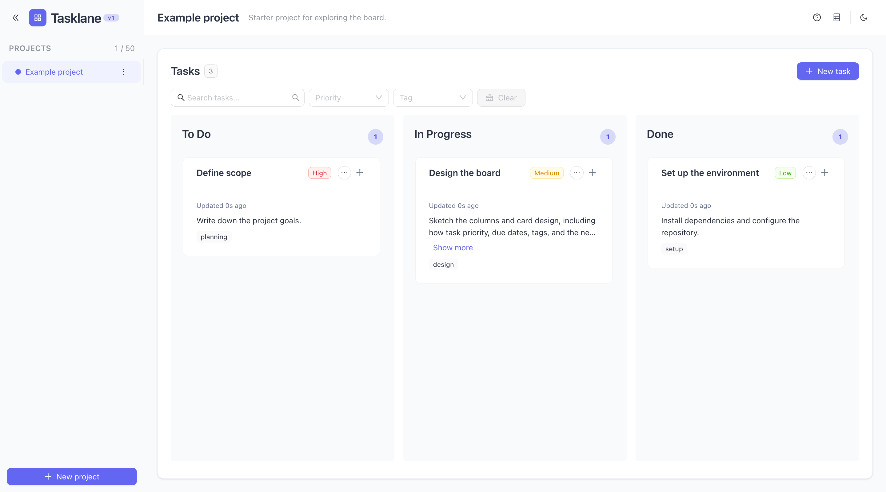
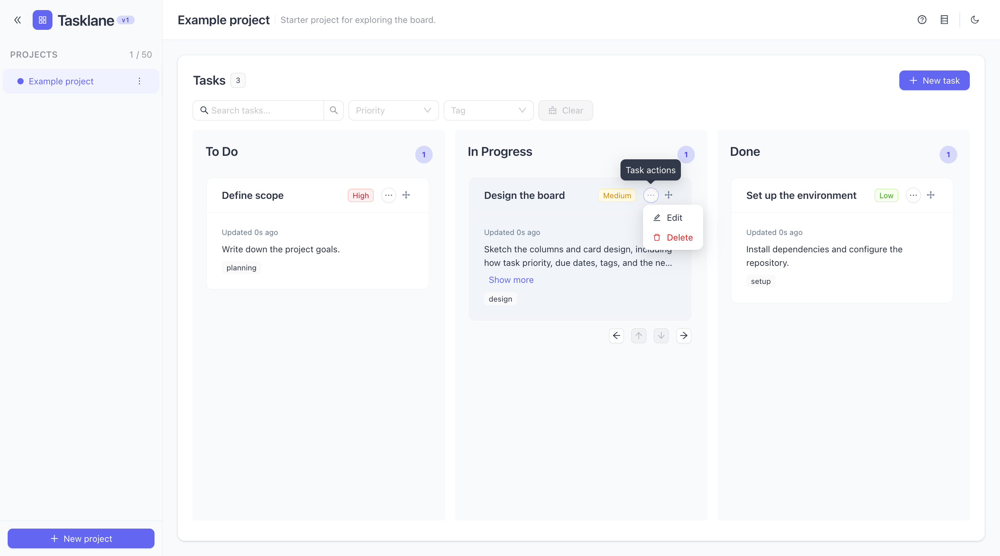
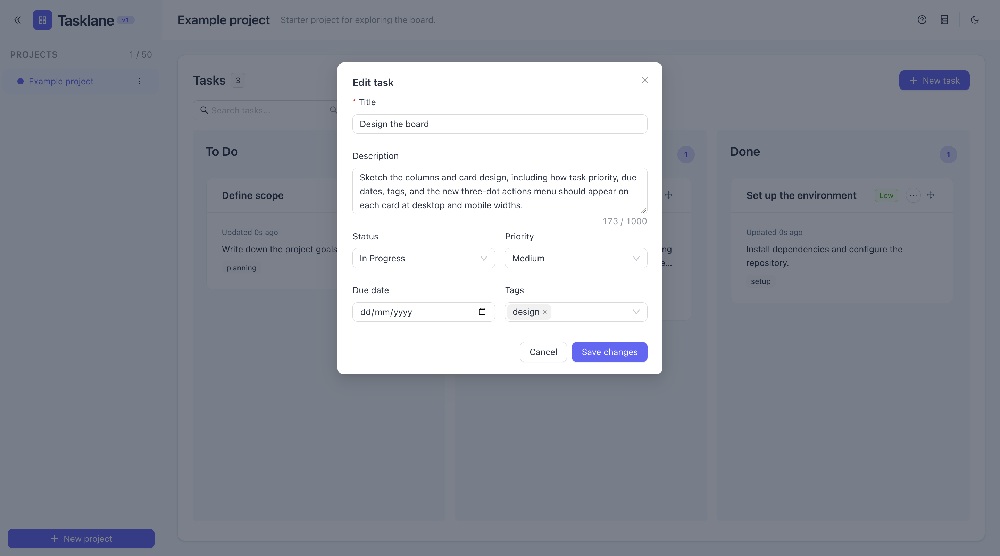
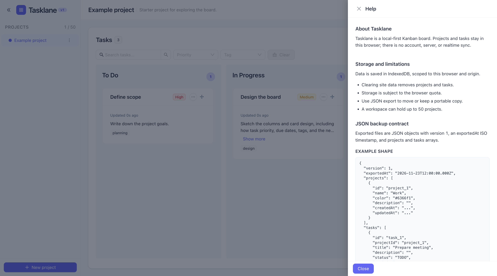

# Tasklane

Tasklane is a local-first Kanban board for organizing projects and tasks in your browser. There is no account, server, or sync: data stays in IndexedDB on the current origin, and JSON export/import is the portable backup path.

## Screenshots









## Features

- Create, edit, and delete projects from the sidebar, with color and description fields.
- Work within a 50-project cap shown as `N / 50` in the sidebar.
- Create, edit, delete, search, and filter tasks by text, priority, and tag.
- Move and reorder tasks across **To Do**, **In Progress**, and **Done** with mouse or keyboard.
- Use compact task cards with priority, due date, tags, a contextual actions menu, and expandable descriptions.
- Switch between light and dark themes; preferences and the active project are remembered locally.
- Export all projects and tasks as a versioned JSON backup, or import a previously exported file.
- Read storage limits, import behavior, and the JSON backup contract from the in-app Help drawer.

## Quick start

Requirements:

- Node.js 20 or newer
- pnpm 12.9.1 (declared in `package.json`)

```shell
git clone https://github.com/christianjtr/simple-task-manager.git
cd simple-task-manager
pnpm install
pnpm dev
```

Useful scripts:

```shell
pnpm dev         # start Vite in development mode
pnpm build       # type check with tsc -b and build for production
pnpm preview     # preview the production build
pnpm check       # Biome format and lint check
pnpm check:fix   # Biome format and lint with fixes
pnpm lint        # Biome lint only
pnpm test        # run the Vitest suite once
pnpm test:watch  # run Vitest in watch mode
pnpm test:e2e    # run the Playwright smoke tests
```

## Data and portability

Tasklane stores two Dexie tables in IndexedDB:

```text
Project { id, name, description?, createdAt, updatedAt }
Task { id, projectId, title, description?, status, priority, tags[], dueDate?, position, createdAt, updatedAt }
```

Use the **Data** menu in the header to export or import a backup:

- **Export JSON** downloads `{ version: 1, exportedAt, projects, tasks }`.
- **Import JSON** validates a file before writing, then persists it in a Dexie transaction.
- Records are matched by ID; an incoming record replaces an existing record with the same ID.
- Duplicate IDs inside a backup and tasks whose project is missing are skipped.
- Import does not delete existing projects or tasks.
- Creation and import are rejected if the result would exceed 50 projects; no partial write is performed.

`src/i18n/en.ts` is the single English UI dictionary. Domain values use `Date` objects and are serialized as ISO 8601 strings at the JSON boundary, validated with Zod.

## Deployment

The `demo` branch is published to GitHub Pages by `.github/workflows/deploy-demo.yml` at `https://christianjtr.github.io/simple-task-manager/`.

- Pull requests targeting `demo` run format/lint, unit tests, and a production build without deploying.
- Pushes to `demo` and manual dispatches run the same checks, then deploy.
- `main` is the source of truth; `demo` mirrors it for publishing.
- The Pages build sets `DEMO_BASE=true`; Vite derives `/simple-task-manager/assets/...` from `GITHUB_REPOSITORY` in Actions.
- Repository setting required: **Settings → Pages → Build and deployment → Source: GitHub Actions**.

To publish:

```shell
git switch main
git push origin main
git switch demo
git merge main
git push origin demo
```

For a local production preview with the demo base path:

```shell
DEMO_BASE=true pnpm build
pnpm preview --host 127.0.0.1 --port 4174
```

## Verification

The current suite has 45 unit tests in 13 files and 3 Playwright smoke tests.

```shell
pnpm check:fix
pnpm check
pnpm build
pnpm test
pnpm test:e2e
DEMO_BASE=true pnpm build
pnpm build
```

Unit and integration tests use `fake-indexeddb/auto` and jsdom polyfills from `src/setupTests.ts`. Playwright smoke tests live in `e2e/`.

For the stage-by-stage modernization and refinement history, see [CHALLENGE.md](CHALLENGE.md).

## Limitations

- Data is local to the current browser profile and origin; clearing site data removes it.
- There is no multi-device sync, collaboration, backend, or authentication.
- Storage is subject to the browser IndexedDB quota.
- A workspace supports at most 50 projects.
- Sidebar collapse state is session-only and resets on reload.
- Task image attachments from the original challenge are not implemented.
- The production build emits a Vite chunk-size warning because Ant Design is bundled into one chunk; it does not affect correctness.

## License

Released under the [MIT License](LICENSE).
